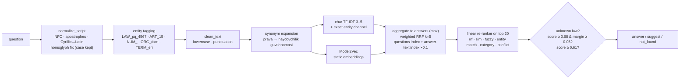
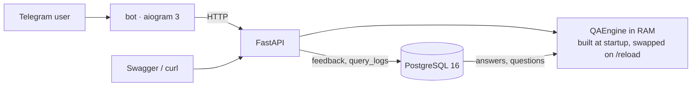

# Uzbek Legal QA — semantic search without LLMs

A question in Uzbek (Latin or Cyrillic) comes in; the system returns the best matching answer from a fixed bank of 505 government-service / legal answers, suggests alternatives when it is unsure, and says "I don't know" when the question is off-topic or cites a law that is not in the data. **No LLM APIs and no transformer models run at inference**: character n-gram TF-IDF, a static Model2Vec embedding table (numpy lookup), rule-based entity handling and a small linear re-ranker. It ships as a FastAPI service with Swagger, a Telegram bot ([@justiceQA_bot](https://t.me/justiceQA_bot)) and PostgreSQL for data, feedback and query logs, all started by one `docker compose up`.

```text
user: prava olish uchun nima kerak
bot:  Quyidagilardan birini nazarda tutdingizmi?
      [Haydovchilik guvohnomasi qancha muddatga beriladi?]
      [Haydovchilik guvohnomasini qanday rasmiylashtirish mumkin?]
      [B toifasidagi haydovchilik guvohnomasini olish uchun yosh c…]
user: PQ-4567 qarori nima haqida?
bot:  Kechirasiz, PQ-4567 bo'yicha ma'lumot bazamda yo'q. Noto'g'ri hujjat haqida javob bermaslik uchun javob qaytarmadim. …
```

| | Our system (CPU) | BGE-M3 dense (benchmark only, GPU) |
|---|---|---|
| Hand-written realistic queries, Top-1 / Top-3 | 67.3% / 82.2% | 80.4% / 92.5% |
| Held-out paraphrases, Top-1 | 99.6% | 99.6% |
| Off-topic questions → "don't know" | 91.3% (0% answered) | — |
| Invented law number → "don't know" | 100% | 0% |
| Latency per query | **5–7 ms on CPU** | 16 ms on GPU, 181 ms on CPU |

---

## 1. Quick start

You need the private data files `answers.csv` and `questions.csv` (or `.xlsx`) and a Telegram bot token.

**Docker (everything):**

```bash
cp answers.csv questions.csv data/        # private data, never committed
cp .env.example .env                      # put BOT_TOKEN=... in .env (or a bot_token.txt file)
make up                                   # = docker compose up --build: db + api + bot
```

On first start the API container creates the schema, imports the data into PostgreSQL and builds the search index in RAM (≈ 20 s; the first image build ≈ 2 min because it downloads the 530 MB embedding table). If port 8000 is taken, set `API_PORT=8010` in `.env` (every `docker compose` command reads it). Stop with `make down`; reset the database with `docker compose down -v`.

**Local (no Docker, Python 3.11):**

```bash
make install           # .venv + runtime and dev dependencies (PYTHON=/path/to/python3.11 if needed)
make models            # download the Model2Vec table into models/ (~530 MB)
make api               # http://localhost:8000/docs (reads data/*.csv directly; PORT=8010 make api if 8000 is busy)
make bot               # second terminal; token from BOT_TOKEN or bot_token.txt (API_URL=http://localhost:8010 for another port)
```

`make test` (193 tests, no database needed), `make lint`, `make eval` (reproduces every number below in ≈ 2 min).

## 2. How to test it

- **Swagger:** <http://localhost:8000/docs>; every endpoint has prefilled Uzbek examples.
- **curl:**

  ```bash
  curl -s localhost:8000/ask -H 'Content-Type: application/json' \
       -d '{"question": "ID-karta qancha muddatga beriladi?"}'
  # {"status":"answer","answer_id":5,"answer":"Bir yoshgacha bo'lgan bolaga — 2 yil, …","confidence":0.99,
  #  "candidates":[{"answer_id":5,"score":0.99,"question":"…","preview":"…"}, …],"entities":[…],"latency_ms":5.3}
  ```

  `status` is `answer` (confident, `answer` filled), `suggest` (top candidates with a representative question each) or `not_found` (`reason: "unknown_law"` when the question cites a law/article absent from the data). `"debug": true` adds per-retriever ranks and re-ranker features.
- **Other endpoints:** `GET /answers/{id}`, `GET /health`, `GET /stats` (data size, config, last evaluation metrics, live usage from `query_logs`), `POST /feedback`, `POST /reload` (re-reads PostgreSQL and swaps the index atomically; the old index keeps serving until the new one is ready).
- **Telegram:** [@justiceQA_bot](https://t.me/justiceQA_bot): `/start` (example buttons), `/help`, `/about` (method + live metrics). Answers come with 👍/👎 (stored in the `feedback` table); uncertain questions get up to three "Did you mean…?" buttons.

## 3. Approach





**Why no transformers.** The task forbids LLMs and transformer inference. Beyond the rule, the constraints suit lexical + static methods: 505 short answers, a CPU budget of < 50 ms per query and a domain where exact identifiers matter more than paraphrase. Model2Vec gives some meaning-level matching from a 530 MB numpy table (a lookup and an average, no network at inference).

**Uzbek specifics.**
- *Apostrophes:* `‘ ’ ʻ ʼ \` ´` all become `'`, so `o‘zgartirish`, `oʻzgartirish` and `o'zgartirish` are one word.
- *Cyrillic:* Uzbek transliteration rules (ш→sh, ў→o', қ→q, ғ→g', ҳ→h, е→ye at the start of a word, …), keeping case so abbreviations survive (`ДХМ`→`DXM`). A word that mixes scripts gets its Cyrillic look-alike letters fixed (the data had one: `egа`).
- *Morphology:* character n-grams handle suffixes (`pasportni`, `pasportimni`), and entity and synonym matching accept an optional Uzbek suffix chain (`DXMga`, `DXM ga`, `markaziga`, `ID-kartamni`, `pravamni`).
- *Legal entities:* law numbers in any spelling or script (`PQ-4567`, `pq 4567`, `ПҚ-4567`, `O'RQ-1074-son`) become one token such as `LAW_pq_4567`, articles `ART_15`, and 29 hand-curated organizations and terms with their abbreviations, long forms and colloquial names (`DXM` = `Davlat xizmatlari markazi`; `JSHSHIR` = `PINFL`; `ERI` only in capitals, because `eri` means "her husband"). These tokens are matched exactly in a separate channel, so `PQ-4567` never blurs into `PQ-4576`. **A law or article that exists nowhere in the data always gets `not_found`**: a wrong law number is worse than no answer.
- *Colloquial / Russian words:* 34 synonym groups (`prava`, `spravka`, `propiska`, `uchyot`, `svet`, `doverennost`, …) append the answer-bank wording to the query.

## 4. Results

**Evaluation design.** The data has 505 answers and 3048 questions, but almost every answer has one original question plus ~5 template variants (`… haqida ma'lumot bering`, `Menga … haqida ayting`); paraphrases of one answer share 86% of their content words. A random held-out split (seed 42: 505 test, 505 validation, 2038 index) is therefore near-saturated (~99%) and cannot rank configurations. So decisions use **validation + a hand-written realistic-dev set** (107 queries), and the headline number is a separate **hand-written realistic test set** (107 queries on different answers: paraphrases, colloquial and Russian words, typos, Cyrillic, abbreviations, keyword queries), never used for tuning. Safety checks: 23 off-topic questions; every test question with an invented law number appended; a different organization swapped in.

**Final system** (`make eval`; thresholds answer ≥ 0.68, suggest ≥ 0.61, margin ≥ 0.05):

| set | Top-1 | Top-3 | answered | precision when answering | suggested (gold in top 3) | not_found |
|---|---|---|---|---|---|---|
| held-out paraphrases (test) | 99.6 | 100.0 | 98.4 | 99.8 | 1.6 (100) | 0.0 |
| entity questions (test subset, 56) | 100.0 | 100.0 | 96.4 | 100.0 | 3.6 | 0.0 |
| **realistic test (hand-written)** | **67.3** | **82.2** | 61.7 | **86.4** | 23.4 (80) | 15.0 |
| off-topic questions (23) | — | — | 0.0 | — | 8.7 | **91.3** |
| invented law numbers (505) | — | — | 0.0 | — | 0.0 | **100.0** |

Latency per query in-process on CPU: p50 5–7 ms, p95 6–9 ms (5.2 / 6.3 ms on an idle machine, 7.3 / 9.0 ms in the latest `make eval` with the Docker stack running alongside); ≈ 11 ms over HTTP.

**Ablation** (Top-1 %; validation / realistic-dev decided, the others are reported):

| # | system | val / dev | test | entity | realistic test |
|---|---|---|---|---|---|
| 0 | random | 0.4 / 0.0 | 0.0 | 0.0 | 0.0 |
| 1 | char TF-IDF (+ entity channel) | 99.2 / 68.2 | 99.0 | 96.4 | 60.7 |
| 2 | BM25 | 99.0 / 53.3 | 99.4 | 98.2 | 54.2 |
| 3 | TF-IDF + BM25 (RRF) | 98.8 / 58.9 | 99.0 | 94.6 | 58.9 |
| 4 | + answer-text index | 99.4 / 61.7 | 99.2 | 96.4 | 61.7 |
| 4* | TF-IDF + answer index ×0.1, RRF k=5, no BM25 | 99.2 / 68.2 | 99.0 | 96.4 | 60.7 |
| 5 | + entity-aware re-ranker | 99.2 / 70.1 | 98.8 | 96.4 | 59.8 |
| 6 | + synonym expansion | 99.2 / 76.6 | 98.8 | 96.4 | 63.6 |
| 7a | + Model2Vec pretrained (**final**) | 99.6 / 82.2 | 99.6 | 100.0 | 67.3 |
| 7b | + Model2Vec distilled from BGE-M3 | 98.6 / 81.3 | 99.0 | 98.2 | 71.0 |

Row 7b needs the distilled table (`make install-bench && make distill`, offline, uses torch and BGE-M3); without it `make eval` skips that row with a warning. Decisions were made with `python -m scripts.evaluate --sweep / --tune-reranker / --calibrate`, which read only validation, realistic-dev and the off-topic dev set.

What the table says:
- **BM25 hurt** on realistic queries (−6.5 dev Top-1) and stays off. Char n-grams handle Uzbek morphology and typos better than word tokens.
- **The answer-text index only helps as a light tie-breaker.** With the textbook RRF k=60, ranks 1 and 2 are nearly tied and the answer index overrode clear question matches (validation 99% → 75%). k=5 and a weight of 0.1 fixed that.
- **Stripping the template filler phrases and stripping apostrophes** were neutral (within one query) and stay off.
- **Synonyms and Model2Vec bring the realistic gains.** Option B (BGE-M3 distilled into a static table, 137 MB) scored higher on the realistic *test* (71.0 vs 67.3) but lost on validation and dev, the sets that decide, so the pretrained `potion-multilingual-128M` is kept. B is a reasonable alternative if image size matters.

**Thresholds** (`reports/thresholds.md`): the answer threshold is the lowest score that keeps ≥ 95% precision when answering on realistic-dev and validation with ≤ 5% of a separate off-topic dev set answered. The suggest threshold trades helpfulness against off-topic suggestions:

| answer ≥ (margin 0.05) | dev answered | dev precision | off-topic answered |
|---|---|---|---|
| 0.55 | 81.3 | 87.4 | 26.7 |
| 0.60 | 77.6 | 91.6 | 16.7 |
| **0.68** | **58.9** | **95.2** | **3.3** |
| 0.75 | 30.8 | 93.9 | 3.3 |

**Comparison with BGE-M3** (benchmark only, not used in the delivered system; `make benchmark`, same splits and metrics):

| system | test Top-1 | realistic Top-1 / Top-3 | invented law → not_found | latency | runs on |
|---|---|---|---|---|---|
| ours: TF-IDF + entities + re-ranker (no embeddings) | 98.8 | 63.6 / 77.6 | 100 | 3.6 ms | CPU |
| **ours: final (+ Model2Vec)** | 99.6 | 67.3 / 82.2 | 100 | 5.2 ms | CPU |
| BGE-M3 dense (568M params, fp16) | 99.6 | **80.4 / 92.5** | 0 | 15.5 ms GPU · 181 ms CPU | GPU |
| BGE-M3 + our engine (untuned hybrid) | 99.4 | 72.0 / 88.8 | 100 | 37.5 ms | GPU |

On held-out paraphrases both systems are at the ceiling. On hand-written queries BGE-M3 is clearly better (80.4% vs 67.3%), almost entirely on true paraphrases (65% vs 24%) and abbreviations, where a contextual model understands meaning that n-grams and a static table cannot. Our system wins everything operational: 35× faster on CPU, a 530 MB numpy table instead of 2.3 GB of weights plus torch, and a rule-based safety layer that never answers an invented law number (BGE-M3 alone: 0%). We did not tune anything to beat BGE-M3; the hybrid row is untuned on purpose.

## 5. Error analysis

- **True paraphrases are the main weakness:** 24% Top-1 on the realistic test, against 65% for BGE-M3. When the user's words share little surface with the stored questions (`Nikohimiz soxta tuzilgan, uni bekor qildirish mumkinmi?`), neither n-grams nor a static table recover the meaning. In the bot this mostly shows up as "Did you mean…?" or "I don't understand" rather than a wrong answer.
- **Precision when answering drops from 95% (dev) to 86% (realistic test).** The thresholds were calibrated on 107 queries; about one in seven confidently answered realistic queries is wrong. Raising `ANSWER_THRESHOLD` trades coverage for precision (see the table above).
- **Near-duplicate answers:** `o'qish yoki ish joyidan ma'lumotnoma` (22) vs `o'qish joyidan ma'lumotnoma` (144) and `guvohnoma dublikati` (16) vs `nikoh guvohnomasi dublikati` (36) are separate answers with almost identical questions; most remaining errors on the held-out split are these pairs. They are kept as separate answers (approved data rule) and are natural "suggest" cases.
- **Colloquial wording:** synonyms help (25% → 50% Top-1 on realistic colloquial queries) but the list is finite. `DXMda ID-karta olsa bo'ladimi` and `nikohdan ajrashish uchun qayerga murojaat qilinadi` still get "I don't understand".
- **Honest caveats about the evaluation:** the realistic dev/test sets and the synonym list were written by the same author, so they share vocabulary. The dev gain on colloquial queries (31 → 81%) is much larger than on the test set (25 → 50%), and the realistic test number is the one to trust. One re-ranker feature (entity match in an answer's own questions) came from analysing two test errors (JSHSHIR ↔ STIR); its weight was decided on the decision sets. Law-number handling is tested with injected numbers, because the data contains a single law reference (`O'RQ-1074`).

## 6. Limitations and future work

- More real user questions (from `query_logs` and 👎 feedback) as paraphrases. This is the cheapest accuracy gain and directly targets the paraphrase gap.
- A learned re-ranker (e.g. LightGBM over the same features) once there is enough feedback; the current one is a hand-tuned linear score.
- Use `feedback` + `query_logs` to find unanswered or mis-answered questions, add them to the bank and re-calibrate thresholds periodically.
- A morphological analyser for Uzbek instead of character n-grams and a suffix regex.
- The synonym list and gazetteer are small and hand-written; they need an owner.
- A vector database only if the bank grows to 100k+ documents. At 500 answers an in-RAM index is faster and simpler.

## 7. Database

PostgreSQL 16 stores data and usage, not the index:

| table | content |
|---|---|
| `answers` | `id`, `category_id`, `topic_id`, `answer`, `status`, timestamps |
| `questions` | `id`, `answer_id` → answers (indexed), `question`, `is_active`, timestamps |
| `feedback` | `query`, `answer_id` (nullable), `helpful`, `source` (`bot`/`api`), `created_at` |
| `query_logs` | `query`, `normalized_query`, `status`, `answer_id`, `confidence`, `latency_ms`, `source`, `created_at` (indexed) |

The schema is managed by Alembic (`alembic/versions/0001_init.py`). `scripts/import_xlsx.py` upserts the data files by id (idempotent; `--if-empty` runs automatically on the first Docker start).

**Why search runs in RAM.** The whole index (2.5k documents, a TF-IDF matrix plus a 3k × 256 embedding matrix) takes milliseconds to query in memory and a few seconds to build. Querying Postgres per request would add latency and a pgvector dependency for no benefit at this size. The API reads answers and questions at startup and on `POST /reload`, and every request writes a `query_logs` row in the background (a failed write never fails the request). Unit tests and `make eval` read the data files directly (`DATA_SOURCE=file`) so they are reproducible without a database; `make test-db` runs the database tests against the compose Postgres in a separate `qa_test` database.

## 8. Project structure

```text
app/
  core/        normalize.py · entities.py · synonyms.py · retrievers/ (tfidf_char, static_emb, bm25)
               fusion.py · ranker.py · engine.py (QAEngine) · data.py (file / Postgres sources) · config.py
  api/         main.py (FastAPI app factory, lifespan, endpoints) · schemas.py (Uzbek examples)
  bot/         main.py · handlers.py · keyboards.py · formatting.py · api_client.py · texts.py (all Uzbek strings)
  db/          models.py · session.py · repository.py (Postgres / JSONL storage for logs and feedback)
  eval/        split · metrics · runner (query sets) · systems (ablation rows) · tuning · calibration · report
scripts/       evaluate.py (--sweep, --tune-reranker, --calibrate) · audit_data.py · build_gazetteer.py
               import_xlsx.py · download_models.py · check_embeddings.py
               distill_bge_m3.py · benchmark_bge_m3.py (offline only, .venv-bench with torch)
data/          gazetteer.yaml · synonyms.yaml · eval_realistic{,_dev}.csv · ood_{questions,dev}.txt
               (+ your private answers/questions files, git-ignored)
reports/       eval_results.json · thresholds.{md,json} · benchmark_bge_m3.{md,json}
alembic/       migrations · docker/entrypoint.sh · Dockerfile · docker-compose.yml · Makefile
tests/         193 tests (+ 5 database tests behind TEST_DATABASE_URL)
```

All thresholds, weights, n-gram ranges and paths live in `app/core/config.py` and can be overridden from the environment or `.env`. `requirements.txt` is runtime only: no torch or transformers in the runtime environment or the Docker image. BGE-M3 runs only in the offline benchmark and distillation scripts, from `requirements-bench.txt`.
